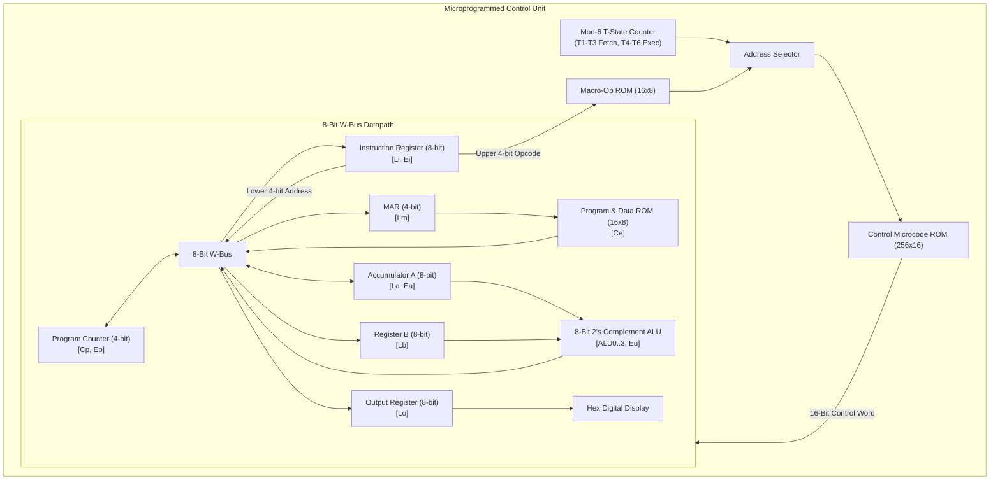

# 8-Bit Microprogrammed SAP-1 CPU in Logisim-evolution

An 8-bit **Simple-As-Possible (SAP-1)** von Neumann CPU architecture implemented and verified in **Logisim-evolution**, featuring a **microprogrammed Control Unit (CU)** driven by a `256 x 16` Control ROM and a `16 x 8` Macro-Op Lookup ROM, alongside a full 8-bit datapath and 2's complement ALU.

---

## 1. System Architecture

The SAP-1 CPU communicates across a shared **8-bit W-Bus** and consists of the following functional blocks:

- **Program Counter (PC)**: 4-bit counter holding the address (`0x0`–`0xF`) of the next instruction to fetch. Controlled by `Cp` (increment) and `Ep` (enable output to W-Bus).
- **Memory Address Register (MAR)**: 4-bit latch (`Lm`) that captures the memory address from the W-Bus to address the `16 x 8` Program/Data Memory.
- **Program & Data Memory (`16 x 8` ROM)**: Stores instructions in the lower addresses (`0x0`–`0x7`) and 8-bit data operands in the upper addresses (`0x8`–`0xF`). Controlled by `Ce` (enable output to W-Bus).
- **Instruction Register (IR)**: Captures the 8-bit instruction (`Li`). Splits the byte into a **4-bit Opcode** (routed to the Control Unit) and a **4-bit Operand Address** (routed to the W-Bus via `Ei`).
- **Accumulator (Register A)**: Primary 8-bit working register (`La` to load from W-Bus, `Ea` to drive W-Bus) feeding the ALU.
- **Register B**: Secondary 8-bit operand register (`Lb` to load from W-Bus) feeding the second input of the ALU.
- **Arithmetic Logic Unit (ALU)**: 8-bit 2's complement adder/subtractor controlled by `ALU0`–`ALU3` mode bits (where `ALU0 = 1` enables 2's complement subtraction $A - B$) and `Eu` (enable ALU result onto the W-Bus).
- **Output Register (`OUT`)**: 8-bit register (`Lo`) driving a dual 7-segment Hex Digital Display.
- **Microprogrammed Control Unit (CU)**: Replaces hardwired combinational logic with a modulo-6 ring/state counter (`T1`–`T6`), a `16 x 8` Macro-Op ROM (mapping 4-bit opcodes to starting microcode addresses), and a `256 x 16` Microcode Control ROM outputting the 16-bit control word.



---

## 2. 16-Bit Control Word Definition

Each entry in the `256 x 16` Control ROM encodes a 16-bit microinstruction word split into four hexadecimal nibbles (`Hex4`, `Hex3`, `Hex2`, `Hex1`), ordered from LSB to MSB in the microcode specification table:

| Bit Position (LSB $\to$ MSB) | Bit 0 | Bit 1 | Bit 2 | Bit 3 | Bit 4 | Bit 5 | Bit 6 | Bit 7 | Bit 8 | Bit 9 | Bit 10 | Bit 11 | Bit 12 | Bit 13 | Bit 14 | Bit 15 |
| :--- | :---: | :---: | :---: | :---: | :---: | :---: | :---: | :---: | :---: | :---: | :---: | :---: | :---: | :---: | :---: | :---: |
| **Control Signal** | `Cp` | `Ep` | `Lm` | `Ce` | `Li` | `Ei` | `La` | `Ea` | `ALU0` | `ALU1` | `ALU2` | `ALU3` | `Eu` | `Lb` | `Lo` | `x` |
| **Hex Weight** | `0001` | `0002` | `0004` | `0008` | `0010` | `0020` | `0040` | `0080` | `0100` | `0200` | `0400` | `0800` | `1000` | `2000` | `4000` | `8000` |
| **Nibble Group** | \multicolumn{4}{c|}{\textbf{Hex 1 (Bits 3..0)}} | \multicolumn{4}{c|}{\textbf{Hex 2 (Bits 7..4)}} | \multicolumn{4}{c|}{\textbf{Hex 3 (Bits 11..8)}} | \multicolumn{4}{c|}{\textbf{Hex 4 (Bits 15..12)}} |

### Signal Descriptions
- **`Cp` (`0x0001`)**: Increment Program Counter (`PC <- PC + 1`).
- **`Ep` (`0x0002`)**: Enable Program Counter onto W-Bus.
- **`Lm` (`0x0004`)**: Load Memory Address Register (`MAR`) from W-Bus.
- **`Ce` (`0x0008`)**: Enable Memory (`ROM 16x8`) data onto W-Bus.
- **`Li` (`0x0010`)**: Load Instruction Register (`IR`) from W-Bus.
- **`Ei` (`0x0020`)**: Enable lower 4-bit operand of `IR` onto W-Bus.
- **`La` (`0x0040`)**: Load Accumulator (`Register A`) from W-Bus.
- **`Ea` (`0x0080`)**: Enable Accumulator (`Register A`) onto W-Bus.
- **`ALU0` (`0x0100`)**: ALU mode bit 0 (`0` = Add $A + B$, `1` = 2's Complement Subtract $A - B$).
- **`ALU1..3` (`0x0200..0x0800`)**: Auxiliary ALU function select bits.
- **`Eu` (`0x1000`)**: Enable ALU output onto W-Bus.
- **`Lb` (`0x2000`)**: Load `Register B` from W-Bus.
- **`Lo` (`0x4000`)**: Load `Output Register` from W-Bus.
- **`x` (`0x8000`)**: Unused / Halt assertion bit (all 16 bits asserted `0xFFFF` triggers `HLT` gate).

---

## 3. Complete Instruction Set & Microcode Table

Every instruction shares the universal 3-cycle **Fetch Routine (`T1`–`T3`)** at microcode addresses `0x00`–`0x02`, followed by an instruction-specific 3-cycle **Execute Routine (`T4`–`T6`)** indexed via the `16 x 8` Macro-Op ROM:

| Mnemonic | Opcode (Upper Nibble) | Macro-Op Start Addr | Routine Addr (Bin / Hex) | T-State | Active Control Signals | Binary (`Cp Ep Lm Ce` \| `Li Ei La Ea` \| `ALU0..3` \| `Eu Lb Lo x`) | Hex Word (`Hex4..1`) | RTL Operation |
| :--- | :---: | :---: | :---: | :---: | :--- | :---: | :---: | :--- |
| **FETCH** | *All* | `Fetch` | `0000` (`0x00`) | **T1** | `Ep, Lm` | `0110` `0000` `0000` `0000` | `0006` | $\text{MAR} \leftarrow \text{PC}$ |
| | | | `0001` (`0x01`) | **T2** | `Cp` | `1000` `0000` `0000` `0000` | `0001` | $\text{PC} \leftarrow \text{PC} + 1$ |
| | | | `0010` (`0x02`) | **T3** | `Ce, Li` | `0001` `1000` `0000` `0000` | `0018` | $\text{IR} \leftarrow \text{MEM}[\text{MAR}]$ |
| **LDA** | `0x0` (`0000`) | `0x03` (`0011`) | `0011` (`0x03`) | **T4** | `Lm, Ei` | `0010` `0100` `0000` `0000` | `0024` | $\text{MAR} \leftarrow \text{IR}[3:0]$ |
| | | | `0100` (`0x04`) | **T5** | `Ce, La` | `0001` `0010` `0000` `0000` | `0048` | $\text{A} \leftarrow \text{MEM}[\text{MAR}]$ |
| | | | `0101` (`0x05`) | **T6** | `-` | `0000` `0000` `0000` `0000` | `0000` | $\text{NOP}$ |
| **ADD** | `0x1` (`0001`) | `0x06` (`0110`) | `0110` (`0x06`) | **T4** | `Lm, Ei` | `0010` `0100` `0000` `0000` | `0024` | $\text{MAR} \leftarrow \text{IR}[3:0]$ |
| | | | `0111` (`0x07`) | **T5** | `Ce, Lb` | `0001` `0000` `0000` `0100` | `2008` | $\text{B} \leftarrow \text{MEM}[\text{MAR}]$ |
| | | | `1000` (`0x08`) | **T6** | `La, Eu` | `0000` `0010` `0000` `1000` | `1040` | $\text{A} \leftarrow \text{A} + \text{B}$ |
| **SUB** | `0x2` (`0010`) | `0x09` (`1001`) | `1001` (`0x09`) | **T4** | `Lm, Ei` | `0010` `0100` `0000` `0000` | `0024` | $\text{MAR} \leftarrow \text{IR}[3:0]$ |
| | | | `1010` (`0x0A`) | **T5** | `Ce, Lb` | `0001` `0000` `0000` `0100` | `2008` | $\text{B} \leftarrow \text{MEM}[\text{MAR}]$ |
| | | | `1011` (`0x0B`) | **T6** | `La, ALU0, Eu` | `0000` `0010` `1000` `1000` | `1140` | $\text{A} \leftarrow \text{A} - \text{B}$ (2's Comp) |
| **OUT** | `0x3` (`0011`) | `0x0C` (`1100`) | `1100` (`0x0C`) | **T4** | `Ea, Lo` | `0000` `0001` `0000` `0010` | `4080` | $\text{OUT} \leftarrow \text{A}$ |
| | | | `1101` (`0x0D`) | **T5** | `-` | `0000` `0000` `0000` `0000` | `0000` | $\text{NOP}$ |
| | | | `1110` (`0x0E`) | **T6** | `-` | `0000` `0000` `0000` `0000` | `0000` | $\text{NOP}$ |
| **HLT** | `0xF` (`1111`) | `0x0F` (`1111`) | `1111` (`0x0F`) | **T4** | All Signals Active | `1111` `1111` `1111` `1111` | `ffff` | Halt Clock (`HLT` Gate Active) |

---

## 4. Test Program & Step-by-Step Verification

The test program loaded into the `16 x 8` Program/Data ROM ([`rom_images/test_program_16x8.hex`](rom_images/test_program_16x8.hex)) validates instruction fetching, memory operand addressing, addition, 2's complement negative result representation, display output, and halting.

### Memory Map (`16 x 8` Program & Data ROM)

| Address (Hex) | Hex Code | Type | Assembly / Meaning |
| :---: | :---: | :---: | :--- |
| `0x00` | `08` | Instruction | `LDA 08` — Load value at address `0x08` (`3`) into Accumulator `A` |
| `0x01` | `19` | Instruction | `ADD 09` — Add value at address `0x09` (`4`) to Accumulator `A` |
| `0x02` | `1a` | Instruction | `ADD 0A` — Add value at address `0x0A` (`7`) to Accumulator `A` |
| `0x03` | `2b` | Instruction | `SUB 0B` — Subtract value at address `0x0B` (`16` / `0x10`) from `A` |
| `0x04` | `30` | Instruction | `OUT` — Output Accumulator `A` to Hex Digital Display |
| `0x05` | `1c` | Instruction | `ADD 0C` — Add value at address `0x0C` (`3`) to Accumulator `A` |
| `0x06` | `30` | Instruction | `OUT` — Output Accumulator `A` to Hex Digital Display |
| `0x07` | `ff` | Instruction | `HLT` — Halt CPU execution |
| `0x08` | `03` | Data | Operand value $= 3$ (`0x03`) |
| `0x09` | `04` | Data | Operand value $= 4$ (`0x04`) |
| `0x0a` | `07` | Data | Operand value $= 7$ (`0x07`) |
| `0x0b` | `10` | Data | Operand value $= 16$ (`0x10`) |
| `0x0c` | `03` | Data | Operand value $= 3$ (`0x03`) |
| `0x0d`–`0x0f` | `00` | Unused | Zero-filled (`0x00`) |

### Execution Trace

| Step | PC | Instruction (`Hex`) | Operation Performed | Register `A` (Hex / Dec) | Register `B` (Hex / Dec) | Hex Display (`OUT`) |
| :---: | :---: | :--- | :--- | :---: | :---: | :---: |
| **Init** | `0x0` | — | Reset state prior to first clock cycle | `0x00` ($0$) | `0x00` ($0$) | `00` |
| **1** | `0x0` | `LDA 08` (`08`) | $\text{A} \leftarrow \text{MEM}[0\text{x}08] = 3$ | `0x03` ($3$) | `0x00` ($0$) | `00` |
| **2** | `0x1` | `ADD 09` (`19`) | $\text{B} \leftarrow \text{MEM}[0\text{x}09] = 4$; $\text{A} \leftarrow 3 + 4 = 7$ | `0x07` ($7$) | `0x04` ($4$) | `00` |
| **3** | `0x2` | `ADD 0A` (`1a`) | $\text{B} \leftarrow \text{MEM}[0\text{x}0\text{A}] = 7$; $\text{A} \leftarrow 7 + 7 = 14$ | `0x0E` ($14$) | `0x07` ($7$) | `00` |
| **4** | `0x3` | `SUB 0B` (`2b`) | $\text{B} \leftarrow \text{MEM}[0\text{x}0\text{B}] = 16$; $\text{A} \leftarrow 14 - 16 = -2$ (2's complement `0xFE`) | `0xFE` ($-2$) | `0x10` ($16$) | `00` |
| **5** | `0x4` | `OUT` (`30`) | $\text{OUT} \leftarrow \text{A}$ (`0xFE` displayed on 7-segment display) | `0xFE` ($-2$) | `0x10` ($16$) | **`FE`** ($-2$) |
| **6** | `0x5` | `ADD 0C` (`1c`) | $\text{B} \leftarrow \text{MEM}[0\text{x}0\text{C}] = 3$; $\text{A} \leftarrow -2 + 3 = +1$ (`0x01`) | `0x01` ($+1$) | `0x03` ($3$) | `FE` |
| **7** | `0x6` | `OUT` (`30`) | $\text{OUT} \leftarrow \text{A}$ (`0x01` displayed on 7-segment display) | `0x01` ($+1$) | `0x03` ($3$) | **`01`** ($+1$) |
| **8** | `0x7` | `HLT` (`ff`) | Control word `0xFFFF` asserted; `HLT` gate stops clock | `0x01` ($+1$) | `0x03` ($3$) | **`01`** ($+1$) |

---

## 5. Repository Structure & Usage

```text
09-sap1-microprogrammed-cpu-logisim/
├── rom_images/
│   ├── control_rom_256x16.hex   # 256x16-bit Control Unit microcode ROM (v2.0 raw)
│   ├── macro_op_rom_16x8.hex    # 16x8-bit Opcode-to-Routine translation ROM (v2.0 raw)
│   └── test_program_16x8.hex    # 16x8-bit Program & Data Memory image (v2.0 raw)
└── README.md
```

### Loading the ROM Images in Logisim-evolution
1. Open your SAP-1 circuit in **Logisim-evolution**.
2. Right-click the **Control ROM (`256 x 16`)** inside the `CU` subcircuit $\to$ **Load Image...** $\to$ select [`rom_images/control_rom_256x16.hex`](rom_images/control_rom_256x16.hex).
3. Right-click the **Address/Macro-Op ROM (`16 x 8`)** inside the `CU` subcircuit $\to$ **Load Image...** $\to$ select [`rom_images/macro_op_rom_16x8.hex`](rom_images/macro_op_rom_16x8.hex).
4. Right-click the **Program/Data Memory ROM (`16 x 8`)** in the main `SAP` datapath $\to$ **Load Image...** $\to$ select [`rom_images/test_program_16x8.hex`](rom_images/test_program_16x8.hex).
5. Reset simulation (`Ctrl+R`) and enable ticks (`Ctrl+K`) to observe the register transfers and Hex Display transitions (`00` $\to$ `FE` $\to$ `01`).
